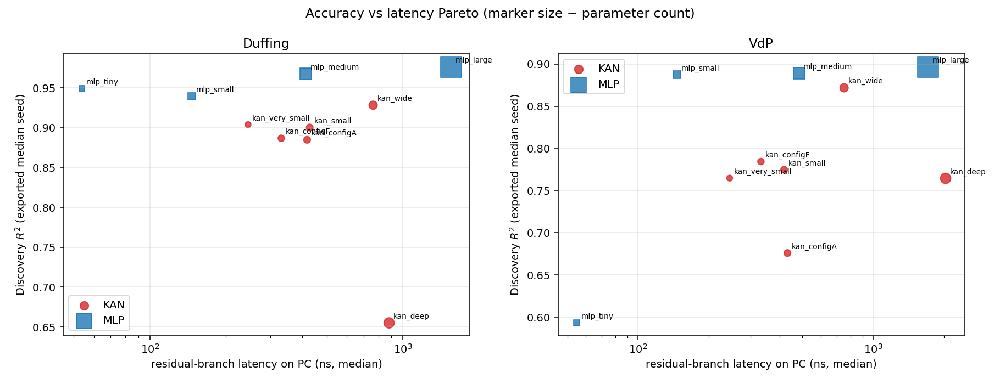
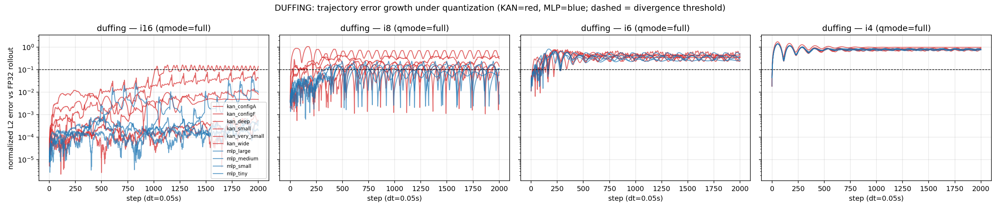
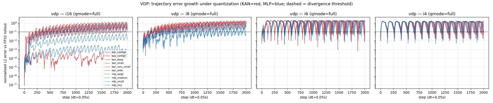

# SBESC 2026 results summary

Generated 2026-07-06T15:01:29 at commit `68c4905` by python/analysis/build_summary.py. Every number traces to a raw CSV under results/.

Units: latency in **ns per call**; energy in **uJ per step**; errors in the **normalized state domain** ([-1,1]^2); Discovery R^2 on the frozen ICLR 50x50 grid over [-2,2]^2.

## Exported models (median-of-5-seeds, BPTT recipe unless noted)

Raw: `models/training_metrics.csv`, per-model `models/*.json`.

| model | arch | system | recipe | params | chosen_seed | trained_ok | discovery_r2 | test_mse | flops/inf | exp/inf |
|---|---|---|---|---|---|---|---|---|---|---|
| duffing_kan_configA | kan | Duffing | tf | 240 | 1 | True | 0.885 | 0.001053 | 2322 | 10 |
| duffing_kan_configF | kan | Duffing | tf | 192 | 5 | True | 0.8868 | 0.001036 | 1826 | 10 |
| duffing_kan_deep | kan | Duffing | bptt | 880 | 3 | True | 0.6551 | 0.001818 | 4986 | 18 |
| duffing_kan_small | kan | Duffing | bptt | 240 | 1 | True | 0.9004 | 0.01217 | 2322 | 10 |
| duffing_kan_very_small | kan | Duffing | bptt | 120 | 3 | True | 0.904 | 0.001794 | 1350 | 6 |
| duffing_kan_wide | kan | Duffing | bptt | 480 | 3 | True | 0.9283 | 0.002035 | 4266 | 18 |
| duffing_mlp_large | mlp | Duffing | bptt | 4417 | 3 | True | 0.9765 | 0.002062 | 8833 | 0 |
| duffing_mlp_medium | mlp | Duffing | bptt | 1185 | 1 | True | 0.9676 | 0.01198 | 2369 | 0 |
| duffing_mlp_small | mlp | Duffing | bptt | 337 | 1 | True | 0.9396 | 0.01179 | 673 | 0 |
| duffing_mlp_tiny | mlp | Duffing | bptt | 105 | 1 | True | 0.9491 | 0.01182 | 209 | 0 |
| vdp_kan_configA | kan | VdP | tf | 240 | 4 | True | 0.6761 | 0.001765 | 2322 | 10 |
| vdp_kan_configF | kan | VdP | tf | 192 | 5 | True | 0.7845 | 0.001396 | 1826 | 10 |
| vdp_kan_deep | kan | VdP | bptt | 880 | 2 | True | 0.7645 | 0.001992 | 4986 | 18 |
| vdp_kan_small | kan | VdP | bptt | 240 | 4 | True | 0.7747 | 0.01841 | 2322 | 10 |
| vdp_kan_very_small | kan | VdP | bptt | 120 | 4 | True | 0.7649 | 0.01833 | 1350 | 6 |
| vdp_kan_wide | kan | VdP | bptt | 480 | 5 | True | 0.8719 | 0.01603 | 4266 | 18 |
| vdp_mlp_large | mlp | VdP | bptt | 4417 | 5 | True | 0.8967 | 0.01559 | 8833 | 0 |
| vdp_mlp_medium | mlp | VdP | bptt | 1185 | 3 | True | 0.8891 | 0.008204 | 2369 | 0 |
| vdp_mlp_small | mlp | VdP | bptt | 337 | 1 | True | 0.8874 | 0.002868 | 673 | 0 |
| vdp_mlp_tiny | mlp | VdP | bptt | 105 | 1 | True | 0.5933 | 0.002866 | 209 | 0 |

## Latency — PC (E1)

Raw: `results/latency_pc/latency.csv`.

### Latency (PC, FP32, ns per call; median over interleaved rounds)

| model | arch | params | flops_est | exps_est | mode | ns_median | ns_p10 | ns_p90 |
|---|---|---|---|---|---|---|---|---|
| duffing_kan_very_small | kan | 120 | 1350 | 6 | residual | 244.4 | 241.4 | 248.1 |
| duffing_kan_very_small | kan | 120 | 1350 | 6 | step | 248.1 | 244.4 | 252.3 |
| duffing_kan_small | kan | 240 | 2322 | 10 | residual | 428.5 | 424.2 | 434.5 |
| duffing_kan_small | kan | 240 | 2322 | 10 | step | 431.7 | 427.0 | 436.1 |
| duffing_kan_wide | kan | 480 | 4266 | 18 | residual | 763.0 | 754.0 | 773.1 |
| duffing_kan_wide | kan | 480 | 4266 | 18 | step | 791.6 | 781.7 | 806.8 |
| duffing_kan_deep | kan | 880 | 4986 | 18 | residual | 882.2 | 876.0 | 890.0 |
| duffing_kan_deep | kan | 880 | 4986 | 18 | step | 884.8 | 878.9 | 894.0 |
| duffing_kan_configA | kan | 240 | 2322 | 10 | residual | 418.4 | 410.9 | 426.6 |
| duffing_kan_configA | kan | 240 | 2322 | 10 | step | 419.0 | 414.2 | 428.1 |
| duffing_kan_configF | kan | 192 | 1826 | 10 | residual | 330.7 | 327.0 | 341.3 |
| duffing_kan_configF | kan | 192 | 1826 | 10 | step | 332.9 | 329.4 | 338.5 |
| duffing_mlp_tiny | mlp | 105 | 209 | 0 | residual | 54.0 | 49.2 | 55.8 |
| duffing_mlp_tiny | mlp | 105 | 209 | 0 | step | 56.3 | 54.3 | 61.1 |
| duffing_mlp_small | mlp | 337 | 673 | 0 | residual | 146.3 | 138.9 | 153.4 |
| duffing_mlp_small | mlp | 337 | 673 | 0 | step | 152.9 | 146.0 | 157.2 |
| duffing_mlp_medium | mlp | 1185 | 2369 | 0 | residual | 414.2 | 404.0 | 418.2 |
| duffing_mlp_medium | mlp | 1185 | 2369 | 0 | step | 416.0 | 403.6 | 432.2 |
| duffing_mlp_large | mlp | 4417 | 8833 | 0 | residual | 1549.0 | 1534.1 | 1560.5 |
| duffing_mlp_large | mlp | 4417 | 8833 | 0 | step | 1556.4 | 1520.5 | 1577.5 |
| vdp_kan_very_small | kan | 120 | 1350 | 6 | step | 243.7 | 239.9 | 249.9 |
| vdp_kan_very_small | kan | 120 | 1350 | 6 | residual | 245.1 | 240.7 | 253.0 |
| vdp_kan_small | kan | 240 | 2322 | 10 | step | 430.6 | 420.4 | 442.2 |
| vdp_kan_small | kan | 240 | 2322 | 10 | residual | 418.0 | 416.1 | 426.2 |
| vdp_kan_wide | kan | 480 | 4266 | 18 | residual | 751.9 | 743.6 | 770.9 |
| vdp_kan_wide | kan | 480 | 4266 | 18 | step | 757.6 | 748.9 | 774.7 |
| vdp_kan_deep | kan | 880 | 4986 | 18 | residual | 2032.8 | 1997.4 | 2061.4 |
| vdp_kan_deep | kan | 880 | 4986 | 18 | step | 2029.9 | 1985.0 | 2053.2 |
| vdp_kan_configA | kan | 240 | 2322 | 10 | step | 438.2 | 432.1 | 445.6 |
| vdp_kan_configA | kan | 240 | 2322 | 10 | residual | 431.6 | 422.2 | 438.3 |
| vdp_kan_configF | kan | 192 | 1826 | 10 | residual | 333.0 | 330.1 | 344.8 |
| vdp_kan_configF | kan | 192 | 1826 | 10 | step | 335.4 | 329.4 | 339.4 |
| vdp_mlp_tiny | mlp | 105 | 209 | 0 | residual | 54.8 | 53.9 | 56.3 |
| vdp_mlp_tiny | mlp | 105 | 209 | 0 | step | 56.9 | 56.3 | 58.0 |
| vdp_mlp_small | mlp | 337 | 673 | 0 | residual | 146.2 | 141.6 | 151.6 |
| vdp_mlp_small | mlp | 337 | 673 | 0 | step | 150.2 | 146.0 | 152.2 |
| vdp_mlp_medium | mlp | 1185 | 2369 | 0 | residual | 483.8 | 475.5 | 497.1 |
| vdp_mlp_medium | mlp | 1185 | 2369 | 0 | step | 473.7 | 457.7 | 484.6 |
| vdp_mlp_large | mlp | 4417 | 8833 | 0 | residual | 1712.1 | 1665.1 | 1727.6 |
| vdp_mlp_large | mlp | 4417 | 8833 | 0 | step | 1720.4 | 1697.3 | 1740.2 |

### KAN/MLP residual-latency ratios at comparable parameter count (H1)

| system | kan | mlp | kan_params | mlp_params | kan_ns | mlp_ns | latency_ratio |
|---|---|---|---|---|---|---|---|
| Duffing | kan_very_small | mlp_tiny | 120 | 105 | 244 | 54 | 4.53 |
| Duffing | kan_small | mlp_small | 240 | 337 | 428 | 146 | 2.93 |
| Duffing | kan_wide | mlp_small | 480 | 337 | 763 | 146 | 5.21 |
| Duffing | kan_deep | mlp_medium | 880 | 1185 | 882 | 414 | 2.13 |
| VdP | kan_very_small | mlp_tiny | 120 | 105 | 245 | 54.8 | 4.47 |
| VdP | kan_small | mlp_small | 240 | 337 | 418 | 146 | 2.86 |
| VdP | kan_wide | mlp_small | 480 | 337 | 752 | 146 | 5.14 |
| VdP | kan_deep | mlp_medium | 880 | 1185 | 2.03e+03 | 484 | 4.2 |

## Latency — BOARD (E1)

*(pending — run scripts/run_bench_board.sh (on the board))*

## Microarchitectural counters (E2)

*(pending — perf unavailable under WSL2; board run is authoritative. Analytical per-inference op counts are in the model table above.)*

## Energy (E3)

*(pending — manual board session; see scripts/energy_protocol.md)*

## Quantization dependability (E4/E5)

Raw: `results/dependability/summaries.csv`, `curves/`, `discovery/`.

### Dependability (E4): closed-loop divergence vs precision (qmode=full, ref=f32, 20 ICs, 2000 steps)

| model | arch | system | precision | diverged_frac | median_div_step | median_mse | max_err_median |
|---|---|---|---|---|---|---|---|
| duffing_kan_configA | kan | Duffing | f32 | 0 | 2001 | 0 | 0 |
| duffing_kan_configA | kan | Duffing | i16 | 0 | 2001 | 1.435e-07 | 0.0009678 |
| duffing_kan_configA | kan | Duffing | i8 | 1 | 329 | 0.01771 | 0.2322 |
| duffing_kan_configA | kan | Duffing | i6 | 1 | 11.5 | 0.1263 | 0.6356 |
| duffing_kan_configA | kan | Duffing | i4 | 1 | 3 | 0.2831 | 0.9238 |
| duffing_kan_configF | kan | Duffing | f32 | 0 | 2001 | 0 | 0 |
| duffing_kan_configF | kan | Duffing | i16 | 0 | 2001 | 6.087e-08 | 0.0007232 |
| duffing_kan_configF | kan | Duffing | i8 | 1 | 358 | 0.009118 | 0.1849 |
| duffing_kan_configF | kan | Duffing | i6 | 1 | 13 | 0.1163 | 0.6203 |
| duffing_kan_configF | kan | Duffing | i4 | 1 | 3 | 0.3663 | 1.051 |
| duffing_kan_deep | kan | Duffing | f32 | 0 | 2001 | 0 | 0 |
| duffing_kan_deep | kan | Duffing | i16 | 0 | 2001 | 0.000757 | 0.08077 |
| duffing_kan_deep | kan | Duffing | i8 | 1 | 39.5 | 0.08081 | 0.4327 |
| duffing_kan_deep | kan | Duffing | i6 | 1 | 10.5 | 0.1791 | 0.6854 |
| duffing_kan_deep | kan | Duffing | i4 | 1 | 3 | 0.2861 | 0.8953 |
| duffing_kan_small | kan | Duffing | f32 | 0 | 2001 | 0 | 0 |
| duffing_kan_small | kan | Duffing | i16 | 0 | 2001 | 3.816e-05 | 0.01608 |
| duffing_kan_small | kan | Duffing | i8 | 1 | 119.5 | 0.01305 | 0.189 |
| duffing_kan_small | kan | Duffing | i6 | 1 | 11 | 0.2322 | 0.7357 |
| duffing_kan_small | kan | Duffing | i4 | 1 | 3 | 0.2824 | 0.8882 |
| duffing_kan_very_small | kan | Duffing | f32 | 0 | 2001 | 0 | 0 |
| duffing_kan_very_small | kan | Duffing | i16 | 0 | 2001 | 2.24e-05 | 0.009558 |
| duffing_kan_very_small | kan | Duffing | i8 | 1 | 6.5 | 0.2753 | 0.8498 |
| duffing_kan_very_small | kan | Duffing | i6 | 1 | 10 | 0.1264 | 0.6232 |
| duffing_kan_very_small | kan | Duffing | i4 | 1 | 3.5 | 0.2742 | 0.8916 |
| duffing_kan_wide | kan | Duffing | f32 | 0 | 2001 | 0 | 0 |
| duffing_kan_wide | kan | Duffing | i16 | 1 | 958.5 | 0.006529 | 0.1534 |
| duffing_kan_wide | kan | Duffing | i8 | 1 | 40.5 | 0.02142 | 0.3424 |
| duffing_kan_wide | kan | Duffing | i6 | 1 | 8.5 | 0.1818 | 0.7371 |
| duffing_kan_wide | kan | Duffing | i4 | 1 | 3 | 0.2801 | 0.9041 |
| duffing_mlp_large | mlp | Duffing | f32 | 0 | 2001 | 0 | 0 |
| duffing_mlp_large | mlp | Duffing | i16 | 0.1 | 2001 | 0.0001301 | 0.05861 |
| duffing_mlp_large | mlp | Duffing | i8 | 1 | 242.5 | 0.01601 | 0.2348 |
| duffing_mlp_large | mlp | Duffing | i6 | 1 | 14 | 0.1124 | 0.6008 |
| duffing_mlp_large | mlp | Duffing | i4 | 1 | 3.5 | 0.2785 | 0.8774 |
| duffing_mlp_medium | mlp | Duffing | f32 | 0 | 2001 | 0 | 0 |
| duffing_mlp_medium | mlp | Duffing | i16 | 0 | 2001 | 1.306e-07 | 0.001082 |
| duffing_mlp_medium | mlp | Duffing | i8 | 1 | 248 | 0.01231 | 0.1571 |
| duffing_mlp_medium | mlp | Duffing | i6 | 1 | 13.5 | 0.1478 | 0.6447 |
| duffing_mlp_medium | mlp | Duffing | i4 | 1 | 3 | 0.2821 | 0.9062 |
| duffing_mlp_small | mlp | Duffing | f32 | 0 | 2001 | 0 | 0 |
| duffing_mlp_small | mlp | Duffing | i16 | 0 | 2001 | 2.107e-07 | 0.001833 |
| duffing_mlp_small | mlp | Duffing | i8 | 1 | 316.5 | 0.005368 | 0.1476 |
| duffing_mlp_small | mlp | Duffing | i6 | 1 | 13 | 0.1296 | 0.6554 |
| duffing_mlp_small | mlp | Duffing | i4 | 1 | 3 | 0.306 | 0.907 |
| duffing_mlp_tiny | mlp | Duffing | f32 | 0 | 2001 | 0 | 0 |
| duffing_mlp_tiny | mlp | Duffing | i16 | 0 | 2001 | 3.351e-08 | 0.0003996 |
| duffing_mlp_tiny | mlp | Duffing | i8 | 1 | 282 | 0.004429 | 0.1466 |
| duffing_mlp_tiny | mlp | Duffing | i6 | 1 | 12.5 | 0.1383 | 0.5918 |
| duffing_mlp_tiny | mlp | Duffing | i4 | 1 | 3 | 0.2876 | 0.9089 |
| vdp_kan_configA | kan | VdP | f32 | 0 | 2001 | 0 | 0 |
| vdp_kan_configA | kan | VdP | i16 | 1 | 264 | 0.3265 | 1.288 |
| vdp_kan_configA | kan | VdP | i8 | 1 | 61 | 1.093 | 1.881 |
| vdp_kan_configA | kan | VdP | i6 | 1 | 9 | 1.15 | 1.651 |
| vdp_kan_configA | kan | VdP | i4 | 1 | 5 | 0.9204 | 1.433 |
| vdp_kan_configF | kan | VdP | f32 | 0 | 2001 | 0 | 0 |
| vdp_kan_configF | kan | VdP | i16 | 1 | 401 | 0.07146 | 0.86 |
| vdp_kan_configF | kan | VdP | i8 | 1 | 78.5 | 0.6633 | 1.566 |
| vdp_kan_configF | kan | VdP | i6 | 1 | 17 | 1.315 | 1.803 |
| vdp_kan_configF | kan | VdP | i4 | 1 | 4 | 0.8363 | 1.29 |
| vdp_kan_deep | kan | VdP | f32 | 0 | 2001 | 0 | 0 |
| vdp_kan_deep | kan | VdP | i16 | 1 | 365.5 | 0.07385 | 0.8052 |
| vdp_kan_deep | kan | VdP | i8 | 1 | 145.5 | 0.2587 | 1.194 |
| vdp_kan_deep | kan | VdP | i6 | 1 | 10 | 1.259 | 1.695 |
| vdp_kan_deep | kan | VdP | i4 | 1 | 3.5 | 0.9274 | 1.393 |
| vdp_kan_small | kan | VdP | f32 | 0 | 2001 | 0 | 0 |
| vdp_kan_small | kan | VdP | i16 | 1 | 575 | 0.01766 | 0.4389 |
| vdp_kan_small | kan | VdP | i8 | 1 | 93.5 | 0.5427 | 1.47 |
| vdp_kan_small | kan | VdP | i6 | 1 | 13 | 1.176 | 1.645 |
| vdp_kan_small | kan | VdP | i4 | 1 | 4 | 0.8977 | 1.397 |
| vdp_kan_very_small | kan | VdP | f32 | 0 | 2001 | 0 | 0 |
| vdp_kan_very_small | kan | VdP | i16 | 0 | 2001 | 2.349e-07 | 0.001621 |
| vdp_kan_very_small | kan | VdP | i8 | 1 | 78.5 | 0.1013 | 0.9619 |
| vdp_kan_very_small | kan | VdP | i6 | 1 | 20 | 1.363 | 1.797 |
| vdp_kan_very_small | kan | VdP | i4 | 1 | 4 | 0.8718 | 1.393 |
| vdp_kan_wide | kan | VdP | f32 | 0 | 2001 | 0 | 0 |
| vdp_kan_wide | kan | VdP | i16 | 1 | 225 | 0.2483 | 1.179 |
| vdp_kan_wide | kan | VdP | i8 | 1 | 119.5 | 0.7037 | 1.618 |
| vdp_kan_wide | kan | VdP | i6 | 1 | 11.5 | 1.216 | 1.722 |
| vdp_kan_wide | kan | VdP | i4 | 1 | 4 | 0.8572 | 1.308 |
| vdp_mlp_large | mlp | VdP | f32 | 0 | 2001 | 0 | 0 |
| vdp_mlp_large | mlp | VdP | i16 | 1 | 567.5 | 0.01928 | 0.4393 |
| vdp_mlp_large | mlp | VdP | i8 | 0.95 | 199.5 | 0.004675 | 0.2121 |
| vdp_mlp_large | mlp | VdP | i6 | 1 | 10.5 | 1.512 | 1.874 |
| vdp_mlp_large | mlp | VdP | i4 | 1 | 4 | 0.8745 | 1.348 |
| vdp_mlp_medium | mlp | VdP | f32 | 0 | 2001 | 0 | 0 |
| vdp_mlp_medium | mlp | VdP | i16 | 1 | 283 | 0.1532 | 1.077 |
| vdp_mlp_medium | mlp | VdP | i8 | 1 | 138 | 0.2059 | 1.174 |
| vdp_mlp_medium | mlp | VdP | i6 | 1 | 12 | 1.651 | 1.936 |
| vdp_mlp_medium | mlp | VdP | i4 | 1 | 3.5 | 1.004 | 1.437 |
| vdp_mlp_small | mlp | VdP | f32 | 0 | 2001 | 0 | 0 |
| vdp_mlp_small | mlp | VdP | i16 | 0 | 2001 | 0.0003833 | 0.06472 |
| vdp_mlp_small | mlp | VdP | i8 | 1 | 146.5 | 0.1106 | 0.942 |
| vdp_mlp_small | mlp | VdP | i6 | 1 | 9.5 | 1.518 | 1.891 |
| vdp_mlp_small | mlp | VdP | i4 | 1 | 3.5 | 0.8807 | 1.375 |
| vdp_mlp_tiny | mlp | VdP | f32 | 0 | 2001 | 0 | 0 |
| vdp_mlp_tiny | mlp | VdP | i16 | 0.05 | 2001 | 8.51e-07 | 0.003161 |
| vdp_mlp_tiny | mlp | VdP | i8 | 1 | 196 | 0.01001 | 0.3532 |
| vdp_mlp_tiny | mlp | VdP | i6 | 1 | 11.5 | 1.194 | 1.666 |
| vdp_mlp_tiny | mlp | VdP | i4 | 1 | 3 | 0.8681 | 1.367 |

### Attribution at INT8 (E4b): which quantization point hurts?

| model | arch | qmode | diverged_frac | median_mse |
|---|---|---|---|---|
| duffing_kan_configA | kan | acts_only | 0 | 9.801e-06 |
| duffing_kan_configA | kan | full | 1 | 0.01771 |
| duffing_kan_configA | kan | input_only | 0 | 2.416e-06 |
| duffing_kan_configA | kan | residual_only | 0 | 9.664e-05 |
| duffing_kan_configA | kan | weights_only | 0 | 0.0001278 |
| duffing_kan_configF | kan | acts_only | 0 | 3.89e-05 |
| duffing_kan_configF | kan | full | 1 | 0.009118 |
| duffing_kan_configF | kan | input_only | 0 | 1.604e-08 |
| duffing_kan_configF | kan | residual_only | 0 | 2.905e-05 |
| duffing_kan_configF | kan | weights_only | 0 | 4.116e-06 |
| duffing_kan_deep | kan | acts_only | 1 | 0.09507 |
| duffing_kan_deep | kan | full | 1 | 0.08081 |
| duffing_kan_deep | kan | input_only | 1 | 0.004066 |
| duffing_kan_deep | kan | residual_only | 1 | 0.0741 |
| duffing_kan_deep | kan | weights_only | 1 | 0.04067 |
| duffing_kan_small | kan | acts_only | 1 | 0.02617 |
| duffing_kan_small | kan | full | 1 | 0.01305 |
| duffing_kan_small | kan | input_only | 0 | 0.0001242 |
| duffing_kan_small | kan | residual_only | 1 | 0.02533 |
| duffing_kan_small | kan | weights_only | 1 | 0.03467 |
| duffing_kan_very_small | kan | acts_only | 0.95 | 0.04768 |
| duffing_kan_very_small | kan | full | 1 | 0.2753 |
| duffing_kan_very_small | kan | input_only | 0 | 1.951e-07 |
| duffing_kan_very_small | kan | residual_only | 1 | 0.2747 |
| duffing_kan_very_small | kan | weights_only | 1 | 0.204 |
| duffing_kan_wide | kan | acts_only | 1 | 0.0111 |
| duffing_kan_wide | kan | full | 1 | 0.02142 |
| duffing_kan_wide | kan | input_only | 0.95 | 0.006416 |
| duffing_kan_wide | kan | residual_only | 1 | 0.02564 |
| duffing_kan_wide | kan | weights_only | 1 | 0.02559 |
| duffing_mlp_large | mlp | acts_only | 1 | 0.007222 |
| duffing_mlp_large | mlp | full | 1 | 0.01601 |
| duffing_mlp_large | mlp | input_only | 1 | 0.008014 |
| duffing_mlp_large | mlp | residual_only | 1 | 0.008309 |
| duffing_mlp_large | mlp | weights_only | 1 | 0.008141 |
| duffing_mlp_medium | mlp | acts_only | 0.4 | 0.001519 |
| duffing_mlp_medium | mlp | full | 1 | 0.01231 |
| duffing_mlp_medium | mlp | input_only | 0 | 1.135e-05 |
| duffing_mlp_medium | mlp | residual_only | 1 | 0.008384 |
| duffing_mlp_medium | mlp | weights_only | 1 | 0.002366 |
| duffing_mlp_small | mlp | acts_only | 0 | 0.0001238 |
| duffing_mlp_small | mlp | full | 1 | 0.005368 |
| duffing_mlp_small | mlp | input_only | 0 | 0.001513 |
| duffing_mlp_small | mlp | residual_only | 1 | 0.004225 |
| duffing_mlp_small | mlp | weights_only | 0 | 8.07e-05 |
| duffing_mlp_tiny | mlp | acts_only | 0 | 2.289e-05 |
| duffing_mlp_tiny | mlp | full | 1 | 0.004429 |
| duffing_mlp_tiny | mlp | input_only | 0 | 4.314e-07 |
| duffing_mlp_tiny | mlp | residual_only | 0 | 0.0001001 |
| duffing_mlp_tiny | mlp | weights_only | 0 | 5.836e-05 |
| vdp_kan_configA | kan | acts_only | 1 | 0.2224 |
| vdp_kan_configA | kan | full | 1 | 1.093 |
| vdp_kan_configA | kan | input_only | 1 | 0.1546 |
| vdp_kan_configA | kan | residual_only | 1 | 1.037 |
| vdp_kan_configA | kan | weights_only | 1 | 0.09946 |
| vdp_kan_configF | kan | acts_only | 1 | 0.01733 |
| vdp_kan_configF | kan | full | 1 | 0.6633 |
| vdp_kan_configF | kan | input_only | 0.75 | 0.001318 |
| vdp_kan_configF | kan | residual_only | 1 | 0.03543 |
| vdp_kan_configF | kan | weights_only | 1 | 0.06984 |
| vdp_kan_deep | kan | acts_only | 1 | 0.003431 |
| vdp_kan_deep | kan | full | 1 | 0.2587 |
| vdp_kan_deep | kan | input_only | 0.2 | 0.0006311 |
| vdp_kan_deep | kan | residual_only | 1 | 0.02601 |
| vdp_kan_deep | kan | weights_only | 1 | 0.0261 |
| vdp_kan_small | kan | acts_only | 1 | 0.005977 |
| vdp_kan_small | kan | full | 1 | 0.5427 |
| vdp_kan_small | kan | input_only | 0.05 | 0.0002757 |
| vdp_kan_small | kan | residual_only | 1 | 0.7572 |
| vdp_kan_small | kan | weights_only | 1 | 0.5722 |
| vdp_kan_very_small | kan | acts_only | 0.2 | 0.0003345 |
| vdp_kan_very_small | kan | full | 1 | 0.1013 |
| vdp_kan_very_small | kan | input_only | 0.05 | 0.0002199 |
| vdp_kan_very_small | kan | residual_only | 1 | 0.02035 |
| vdp_kan_very_small | kan | weights_only | 1 | 0.0159 |
| vdp_kan_wide | kan | acts_only | 1 | 0.01073 |
| vdp_kan_wide | kan | full | 1 | 0.7037 |
| vdp_kan_wide | kan | input_only | 1 | 0.005856 |
| vdp_kan_wide | kan | residual_only | 0.4 | 0.0005291 |
| vdp_kan_wide | kan | weights_only | 1 | 0.02223 |
| vdp_mlp_large | mlp | acts_only | 0 | 9.025e-05 |
| vdp_mlp_large | mlp | full | 0.95 | 0.004675 |
| vdp_mlp_large | mlp | input_only | 0.15 | 0.000356 |
| vdp_mlp_large | mlp | residual_only | 0.35 | 0.0002856 |
| vdp_mlp_large | mlp | weights_only | 0 | 0.0001165 |
| vdp_mlp_medium | mlp | acts_only | 1 | 0.009319 |
| vdp_mlp_medium | mlp | full | 1 | 0.2059 |
| vdp_mlp_medium | mlp | input_only | 1 | 0.01082 |
| vdp_mlp_medium | mlp | residual_only | 0.45 | 0.0006527 |
| vdp_mlp_medium | mlp | weights_only | 1 | 0.03442 |
| vdp_mlp_small | mlp | acts_only | 0.3 | 0.0006266 |
| vdp_mlp_small | mlp | full | 1 | 0.1106 |
| vdp_mlp_small | mlp | input_only | 0 | 6.293e-05 |
| vdp_mlp_small | mlp | residual_only | 1 | 0.1358 |
| vdp_mlp_small | mlp | weights_only | 1 | 0.1219 |
| vdp_mlp_tiny | mlp | acts_only | 0.25 | 0.000294 |
| vdp_mlp_tiny | mlp | full | 1 | 0.01001 |
| vdp_mlp_tiny | mlp | input_only | 0 | 6.309e-05 |
| vdp_mlp_tiny | mlp | residual_only | 1 | 0.297 |
| vdp_mlp_tiny | mlp | weights_only | 1 | 0.2919 |

### Quantized Discovery R^2 (E5) — the ICLR metric through the quantized engine

| system | arch | model | f32 | i16 | i8 |
|---|---|---|---|---|---|
| Duffing | kan | duffing_kan_configA | 0.8850 | 0.9160 | 0.9158 |
| Duffing | kan | duffing_kan_configF | 0.8868 | 0.7849 | 0.7836 |
| Duffing | kan | duffing_kan_deep | 0.6551 | 0.6590 | -0.2006 |
| Duffing | kan | duffing_kan_small | 0.9004 | 0.8872 | 0.8793 |
| Duffing | kan | duffing_kan_very_small | 0.9040 | 0.9749 | -0.0981 |
| Duffing | kan | duffing_kan_wide | 0.9283 | 0.9335 | 0.8620 |
| Duffing | mlp | duffing_mlp_large | 0.9765 | 0.9653 | 0.9622 |
| Duffing | mlp | duffing_mlp_medium | 0.9676 | 0.9366 | 0.9392 |
| Duffing | mlp | duffing_mlp_small | 0.9396 | 0.9100 | 0.9123 |
| Duffing | mlp | duffing_mlp_tiny | 0.9491 | 0.9216 | 0.9202 |
| VdP | kan | vdp_kan_configA | 0.6761 | 0.6678 | 0.6686 |
| VdP | kan | vdp_kan_configF | 0.7845 | 0.7732 | 0.7693 |
| VdP | kan | vdp_kan_deep | 0.7645 | 0.7557 | 0.7515 |
| VdP | kan | vdp_kan_small | 0.7747 | 0.7729 | 0.7711 |
| VdP | kan | vdp_kan_very_small | 0.7649 | 0.7596 | 0.7525 |
| VdP | kan | vdp_kan_wide | 0.8719 | 0.8472 | 0.8403 |
| VdP | mlp | vdp_mlp_large | 0.8967 | 0.8737 | 0.8710 |
| VdP | mlp | vdp_mlp_medium | 0.8891 | 0.8929 | 0.8911 |
| VdP | mlp | vdp_mlp_small | 0.8874 | 0.8729 | 0.8718 |
| VdP | mlp | vdp_mlp_tiny | 0.5933 | 0.6008 | 0.5913 |

## Memory footprint (E6)

| model | params | bytes_f32 | bytes_i16 | bytes_i8 |
|---|---|---|---|---|
| duffing_kan_configA | 240 | 1344 | 672 | 336 |
| duffing_kan_configF | 192 | 1072 | 536 | 268 |
| duffing_kan_deep | 880 | 4032 | 2016 | 1008 |
| duffing_kan_small | 240 | 1344 | 672 | 336 |
| duffing_kan_very_small | 120 | 720 | 360 | 180 |
| duffing_kan_wide | 480 | 2592 | 1296 | 648 |
| duffing_mlp_large | 4417 | 17668 | 8834 | 4417 |
| duffing_mlp_medium | 1185 | 4740 | 2370 | 1185 |
| duffing_mlp_small | 337 | 1348 | 674 | 337 |
| duffing_mlp_tiny | 105 | 420 | 210 | 105 |
| vdp_kan_configA | 240 | 1344 | 672 | 336 |
| vdp_kan_configF | 192 | 1072 | 536 | 268 |
| vdp_kan_deep | 880 | 4032 | 2016 | 1008 |
| vdp_kan_small | 240 | 1344 | 672 | 336 |
| vdp_kan_very_small | 120 | 720 | 360 | 180 |
| vdp_kan_wide | 480 | 2592 | 1296 | 648 |
| vdp_mlp_large | 4417 | 17668 | 8834 | 4417 |
| vdp_mlp_medium | 1185 | 4740 | 2370 | 1185 |
| vdp_mlp_small | 337 | 1348 | 674 | 337 |
| vdp_mlp_tiny | 105 | 420 | 210 | 105 |

## Claims checklist (hypothesis -> evidence)

| Hypothesis | Evidence | Where |
|---|---|---|
| H1: KAN has higher per-step latency than MLP at comparable params | `latency_ratio` column | latency tables, `results/latency_board/aggregated.csv` |
| H1 mechanism: transcendental + basis-recursion overhead | `flops_est`, `exps_est`; branch/cache counters | model table; `results/perf_*/perf.csv` |
| H2: KAN consumes more uJ/step | `uJ_per_step` column | `results/energy_board/aggregated.csv` |
| H3: KAN degrades worse under low-bit quantization in the loop | `diverged_frac`, `median_div_step` by precision | `results/dependability/aggregated_full.csv` |
| H3 mechanism attribution | i8 input/weights/acts-only rows | `results/dependability/aggregated_attribution_i8.csv` |
| Discovery quality vs precision (ICLR metric bridge) | quantized Discovery R^2 | `results/dependability/discovery_r2_by_precision.csv` |
| Accuracy-latency trade-off (anti-strawman) | Pareto figures | `results/figures/pareto_*.png` |

